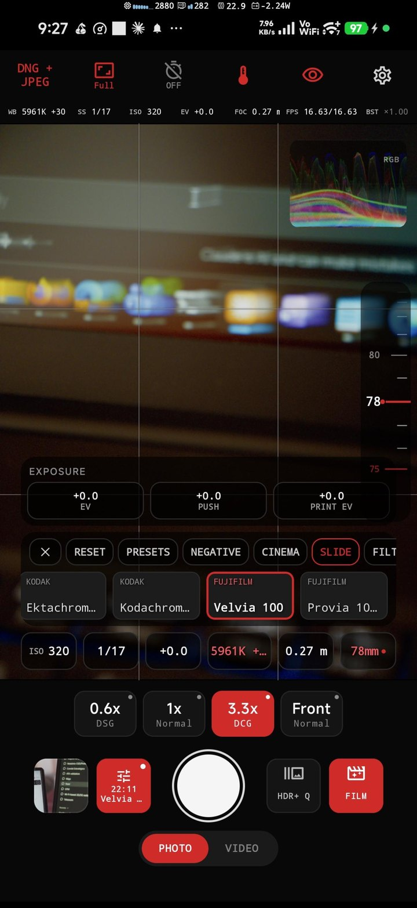
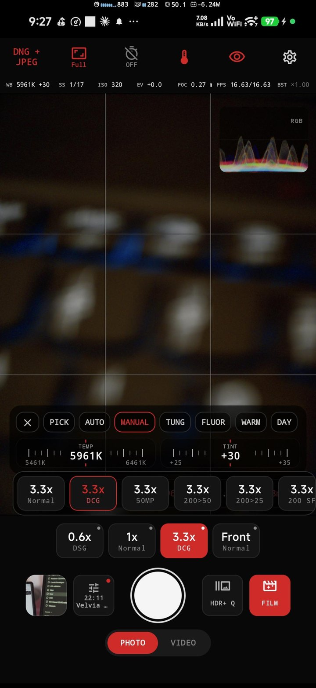
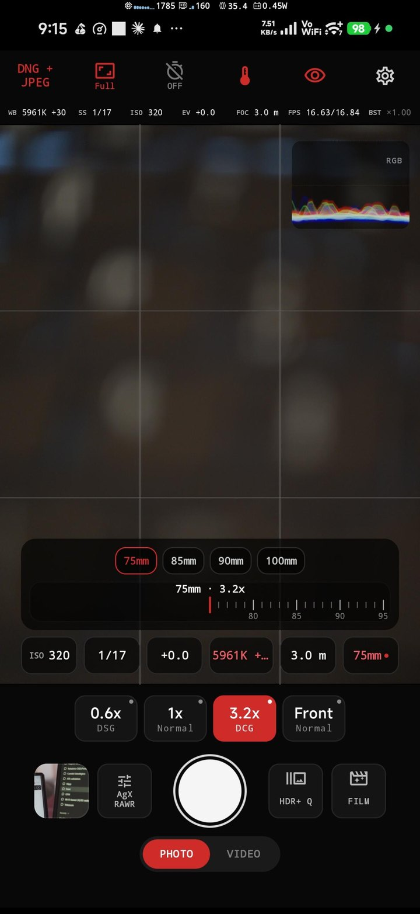
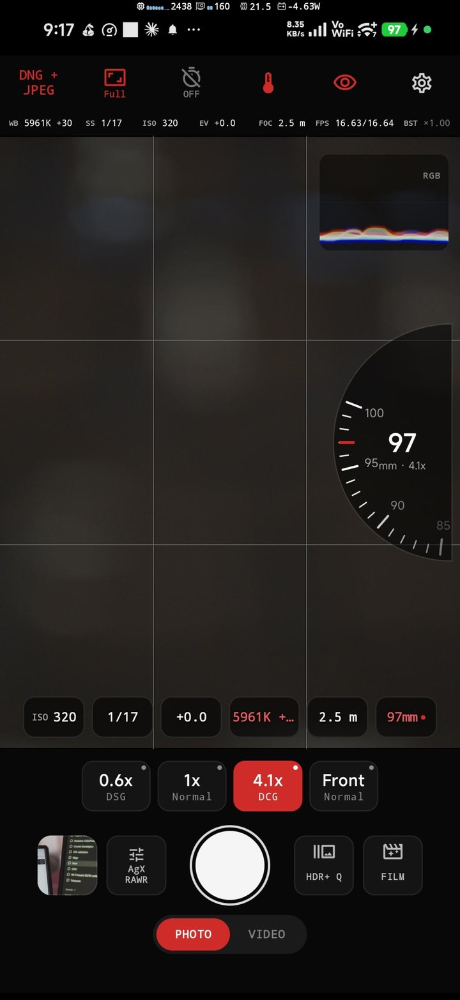
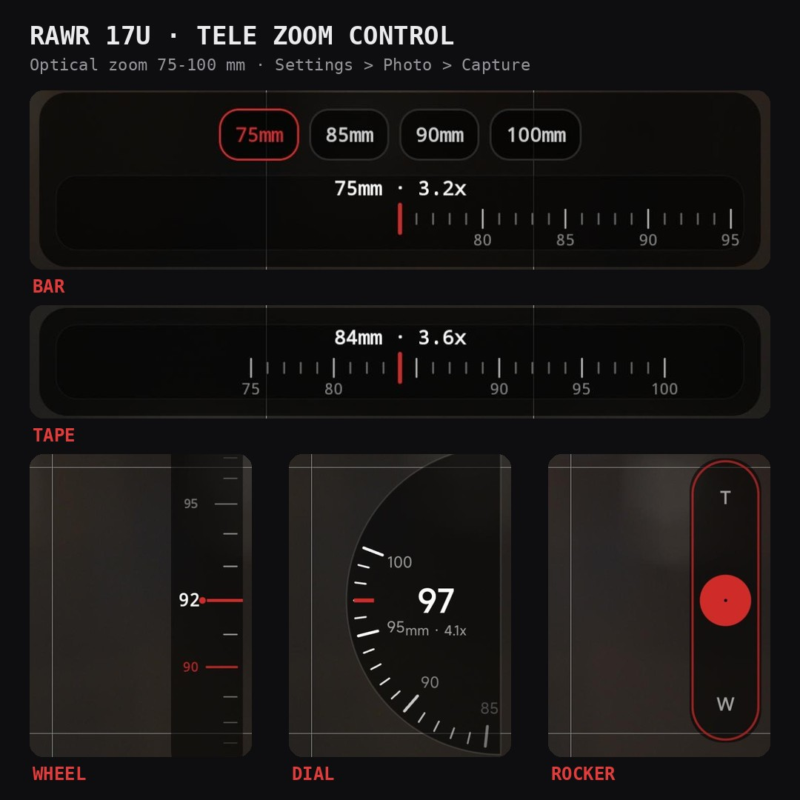

<p align="center">
  
</p>

# Rawr 17U

> **Rawr 17U - unofficial modified version of Rawr.**
> Based on Rawr 0.5.1 by adityawarmanfw (GPL-3.0-only, see `NOTICE` and `LICENSE`), synced with its main
> branch up to #165:
> [github.com/adityawarmanfw/rawr](https://github.com/adityawarmanfw/rawr)
>
> Modified by Paulo Gonçalves ([@utalpt](https://github.com/utalpt)), November 2026. Not affiliated with
> or endorsed by the original author. Changes in this version are listed under
> [What this fork adds](#what-this-fork-adds-xiaomi-17-ultra).
> The release build installs as `x17u.rawr.camera` ("Rawr 17U") and the debug build as
> `x17u.rawr.camera.debug`, next to the official app.

<table align="center">
  <tr>
    <td align="center"><br><sub>Film looks</sub></td>
    <td align="center"><br><sub>Lens modes and WB</sub></td>
    <td align="center"><br><sub>Tele zoom 75-100 mm</sub></td>
    <td align="center"><br><sub>Tele zoom dial</sub></td>
  </tr>
</table>

## Download (Xiaomi 17 Ultra)

- Release (recommended): [latest release](https://github.com/utalpt/rawr/releases/latest), file
  `rawr17u-<version>.apk`. Installs as `x17u.rawr.camera` ("Rawr 17U"); versions are named after the Rawr
  version they build on, e.g. `0.5.1-17u.1`, and each one installs over the previous.
- Watch Remote: the watch app is `rawr17u-remote-wear-<version>.apk` on the same release, installed on a Wear
  OS watch paired with the phone (same version as the phone app).
- Test build: [rawr-debug.apk](https://github.com/utalpt/rawr/releases/download/debug/rawr-debug.apk)
  ([release page](https://github.com/utalpt/rawr/releases/tag/debug)). Every push to `xiaomi-17u` rebuilds it;
  install it over the previous one.
- Lens setup (50 MP, 200 MP tele, vendor keys, merge limits) is built into the APK. If you restored an older
  backup or edited lenses, use **Settings > Lenses > Reset to device default** (bottom of the list) to get the current profile.
- Optional recommended settings: [`presets/Rawr17U-recommended.zip`](presets/Rawr17U-recommended.zip). Import it
  with **Settings > System > About > Backup > Import Backup**. It holds settings only (no lens profiles):
  - Multiframe on (Rexture, 17 frames, Chroma Denoise on)
  - RAWR look contrast +61, capture sharpening Medium
  - Highlight recovery off, distortion correction off, AgX preset Default

## What this fork adds (Xiaomi 17 Ultra)

Everything the fork adds, kept here also once Ed has taken it into Rawr: those items say *(Already in
Rawr: Ed's #N)*, with the pull request it came in. Entry by entry, with how each was checked:
[CHANGELOG.md](CHANGELOG.md). Synced with Ed's main up to #169 (27 Nov 2026).

**Photo: 50 and 200 MP**
- **50 MP RAW** on the main, tele and ultra-wide cameras: the viewfinder streams the binned 4:3 RAW at 30 fps
  with continuous and tap AF, and the shutter takes one full-size still. Multiframe merges up to 30 full-size
  frames (17 by default, memory-aware: strips when the merge does not fit). *(Already in Rawr: Ed's #143, the
  17 Ultra and 15 Ultra built-in profiles.)*
- **200 MP tele** at 3.2x and 4.3x: `200>50` merges up to 6 frames into a 50 MP DNG (2x2 binning of the
  quad-Bayer blocks), `200>25` the same at 25 MP, and `200 SF` writes one full 200 MP DNG (about 200 MB).
  *(Already in Rawr: Ed's #143.)*
- **Zero-copy 200 MP bursts:** the GPU reduces each 200 MP frame straight from the camera buffer, with no
  CPU unpack; the 6 frames are in after about 1.5 s (2.7-4.7 s before). *(Already in Rawr: Ed's #144.)*
- **The 200 MP JPEG developed straight from the 4x4 blocks** (no stair-stepped edges from binning the
  remosaicked frame), with the fork's own fast 200 MP remosaic for the DNG (about 0.8-0.9 s on the 17U; the
  generic CPU remosaic took ~16 s). Ed's Rawr has since added its own GPU remosaic for these blocks (#129);
  the two have not been compared on the 17U.
- **Lost companion buffers** on full-size stills no longer fail the photo (Xiaomi's HAL drops the small
  companion output while the RAW arrives). *(Already in Rawr: Ed's #143, as the per-lens
  ignoreLostCompanion workaround.)*
- **Focus after a 1x 50 MP single frame:** the lens is held at its distance for a few frames after the
  still, so the viewfinder no longer jumps. *(Already in Rawr: Ed's #141.)*
- **HDR+ Bracketed** (Settings > Photo > Multiframe > Merge Algorithm, off by default): HDR+ Quality on a burst
  exposed darker so bright areas do not clip, brightened back, plus frames right after the shutter (brighter ones for
  the shadows, a darker one for the highlights; hold still until the tick). Written by Steve (his v26 patch); it runs
  on its own copy of the merge code and shaders, so Ed's HDR+ Quality and Rexture are unchanged, and
  `-Prawr.hdrb=false` builds without it. Ed's main had removed its own HDR+ Bracketed.
- **Photo aspect ratios:** 3:2 (35 mm), 5:4, 1:1, 16:9, 2.39:1 Scope and XPan 65:24, from the picker in
  the top bar. The JPEG and its gain map are cropped, the DNG stays full; 3:2 and 16:9 fill the screen width
  in the viewfinder, like 16:9 video.
- **Padded raw edges** dropped per lens (`image.cropEdges`), for stills and the viewfinder. *(Already in
  Rawr: Ed's #150.)*

**Lenses and controls**
- One lens button per focal length (0.6x, 1x, tele) with a
  variant picker: `Normal`, `50MP`, `200>50` / `200>25` / `200 SF`, `ISZ` (in-sensor zoom) and the dual-gain
  readouts `DCG`, `DSG`, `DAG` (14-bit, with a per-lens ISO cap).
- **Tele optical zoom from 75 to 100 mm:** the periscope moves to any focal length in between (one tele
  button, named by the zoom the optics are at, 3.2x to 4.3x), from a **TELE** cell in the exposure row. Settings
  > Photo > Capture > Tele Zoom Control picks the control: **Bar** (presets and a FOCAL tape above the exposure row),
  **Tape** (the FOCAL tape alone) or
  **Wheel**, **Dial** or **Rocker** on the viewfinder's edge, reused from the
  [Telezoom](https://github.com/utalpt/x17u-telezoom) module; **Tele Zoom Always On** keeps it on screen while
  the tele is selected. The tele opens at 75 mm (3.2x); Settings > Lenses lists its modes as
  "Tele Normal", "Tele DCG"... (7 instead of 14: the 3.2x ones were the 4.3x ones at rest, spotted by @rifandaadam). EXIF and DNG name the real focal length. The
  vendor tags were found by Anton Tretiakov (@designation_zero).

  

- Lens bar grouping (Auto / Grouped / All) and button size (Compact / Normal / Large), from the eye panel.
- **Exposure memory** (Settings > Viewfinder & controls > Control Style): **Per camera**, each lens keeps its own exposure mode,
  ISO, shutter, EV and WB, or **Shared**, one set for every lens (focus stays per lens).
- **S/I Toggle** (Settings > Photo > Capture, off by default): one tap switches between ISO priority and shutter
  priority, each entered with its saved value (ISO 50 and 1/1000 s by default), from a top-bar button (long press:
  Auto) or an S / I tab on the fixed exposure cell. Asked for by @iG0Lka_ru.
- Each lens can keep its own frame count, look, tone and film.
- Manual ISO shows the standard numbers on the third stops (80, 160, 320, 640, 1250 instead of 79, 159,
  317, 635, 1270).
- **Top sheet:** the quick panel (AE / metering, highlights, detail, frames per lens) and the eye panels
  (MONITORING, VF CONTROLS) as one sheet docked at the top of the viewfinder, with tabs and one row of chips;
  a swipe down from the top third or the eye button opens it, and the scopes move out of its way (portrait and
  landscape). Exposure row with tap-to-set slider bar, RESET and UNDO; camera controls persist across restarts.
- AgX quick card with advanced grids, long-press help on controls; a dot marks a changed value on the film,
  AgX and tone cards.

**Film**
- **Film sheet:** turning FILM on opens the stocks as cards in tabs (presets, negative, cinema, slide, print
  paper, filter, grain, halation), with the tab's settings above them; tap a card to use it.
- **Hold a card to compare** without changing anything: the viewfinder splits down the middle, the look in
  use on the left and the held card on the right, with a line and both names. Halation cards fill the whole
  viewfinder, and grain cards open a **grain loupe** (the middle of the frame x4, the grain rendered at about
  a photo's pixel size, since the normal viewfinder renders the film too small for grain to show).
- **RESET** back to the preset in use (or the default look), with UNDO for 5 seconds; switching back to one of
  the last two stocks is instant (the film engines are kept).
- **ALL PARAMS** (the last tab of the film sheet): every film parameter in three rows in the sheet's space -
  sections, subsections, and the values five across. A section whose switch is off shows OFF and its values are
  dimmed (they stay editable); the idea comes from apos-fandango's Rawr X14U fork.
- **A photo's look as a preset:** every JPEG now carries the processing recipe a DNG already carries (Ed's), and
  "+ FROM PHOTO" in the PRESETS tab (or Import look file in Settings) turns a JPEG or DNG taken with Rawr into a
  preset named after the shot's time and film, never saving the same look twice; JPEGs exported from the
  Renderer carry the edited look. The idea of keeping each shot's recipe comes from apos-fandango's Rawr X14U fork.
- Themes (Leica, Mono, Steel, Sage, Custom), button shapes, and a layout that stays upright in landscape.

**Viewfinder and settings**
- **Clean viewfinder:** no look chips over the picture. A **LOOK button** left of the shutter (the gallery
  further out) shows the look in use, with a dot when its parameters were changed; a long press opens the Look
  settings. It opens a **look sheet** in the film sheet's format: the looks as swipeable cards, the parameters
  as tabs (TONE, COLOUR, OUTPUT; AgX RANGE, CURVE, LOOK and ADV) with RESET/UNDO; with Film on it opens the
  film sheet. PHOTO / VIDEO is a capsule.
- **Scopes:** translucent, borderless cards with the mode in the corner (LUMA, RGB, PARADE, VECTOR), lines at
  0/50/100% and clipping in red, and an **RGB PARADE** waveform mode; they hide while a film card is held.
- **Scrub readout:** a slim capsule near the top of the viewfinder while a control is scrubbed.
- **Shutter Sound** (off by default): the system's camera sounds for photos and for the start and end of a
  recording, the start tone played before the microphone opens. Asked for by @iG0Lka_ru. On phones whose system
  asks for the sound (some regions require it), **Follow System Shutter Rule** decides whether that wins over
  the switch (on by default); found and written by Steve.
- **Voice Shutter** (Settings > Photo > Capture, off by default): say "Capture", "Cheese" or "Say cheese" to take a photo in
  Photo mode. An offline recognizer (Vosk's small English model, Apache-2.0) runs on the phone, only while the
  viewfinder is open; nothing is recorded or sent. Only the exact word fires (look-alikes such as "cheers" do
  not), so the pronunciation matters: "Capture" and "Say cheese" are the more reliable ones. Written by Steve.
- **Watch Remote** (Settings > Photo > Capture, off by default): the viewfinder on a paired Wear OS watch, which
  takes photos, through **Rawr Remote**, the watch app (`rawr17u-remote-wear-<version>.apk` on the release,
  installed on the watch). Written by Steve.
- **Settings by intent:** Photo, Look, RAW development, Video, Viewfinder & controls, Lenses, System, with a
  **search** whose index is generated at build time from the settings pages (a result opens its page with
  the setting highlighted). The lens editor keeps the basics on the lens page and the sensor tuning under
  Advanced.

**White balance**
- **WB strip** (portrait): PICK, AUTO, MANUAL, the camera's presets, SENSOR and the TEMP / TINT rails in a
  strip just above the exposure row, instead of a panel over the middle of the viewfinder.
- **Pick neutral** (WB panel > PICK NEUTRAL, then tap something truly white or grey): Rawr measures that
  area and switches to Manual with the temperature and tint that make it neutral; warm picks correct about
  halfway, keeping some of the light's warmth.
- **Manual WB renders with the requested gains as white**, so the JPEG matches the DNG (it took the HAL's
  own neutral before, a magenta cast). *(Already in Rawr: Ed's #142.)*

**Language**
- The interface in **Portuguese, Spanish, French, German, Italian, Russian, Ukrainian and Polish** (machine-made),
  **Turkish** (by @agabey_42) and **Bengali** (by @arcticstellar), following the phone or chosen in Settings >
  System > Language, with **Export / Import language file** (JSON, English as
  the key) to correct a translation or add a language without a new build. The list of texts is generated
  from the sources at build time.

**Video**
- **4K60 10-bit without dropped frames:** a fast path that demosaics, shades, white-balances, applies the
  look and writes P010/NV12 for the encoder in one GPU pass (0 dropped frames over 3 minutes, phone at
  ~4-5 W instead of ~8-12 W), with the encoder fed straight from the GPU.
- **60 fps sensor modes:** the blank rows they pad are left out of the viewfinder, metering and recording
  (`image.cropEdgesHighFps`), on the rear lenses and the front camera. *(Already in Rawr: Ed's #150.)*
- **Open Gate** at 60 fps records 3408x2560 (4:3), the same box as the viewfinder; 4096x3072 at 30 fps.
- **The tele's DCG and ISZ record at 30 fps** (their sensor modes run 30; at 60 the camera HAL aborted), with the
  fps button showing 30 there; the ceiling check is the-marox's from his PR #3.
- **Recording aspect ratios (cinema formats):** 1.43:1 IMAX 70mm, 1.66:1 European, 1.85:1 Flat, 1.90:1 DCI /
  IMAX digital, 2:1 Univisium, 2.20:1 Todd-AO 70mm, 2.39:1 Scope, 2.76:1 Ultra Panavision 70 and XPan
  65:24.
- **Gyro stabilisation** (Standard, Strong) and **Level horizon**, built on apos-fandango's gyro integrator
  from the Rawr X14U fork.
- **Clean recording view** (controls fade out, a swipe shows them) and **Do not disturb while recording**;
  the scopes refresh about 10 times a second while recording, to leave the GPU to the video.
- Light meter (lux, EV, colour temperature, flicker, laser distance), antibanding from the flicker sensor
  and a Gyroflow gyro log (.gcsv beside the video), from the-marox's PR #1. The same PR saves the readings
  with each photo: lux, colour temperature, flicker and laser distance in the DNG's metadata, the barometer's
  pressure in the EXIF, and, with location tagging on, the lens direction from the compass (GPSImgDirection).

**Galaxy S23 Ultra**
- Faster lens switching (median 2.6 s to 0.6-0.7 s) and app launch: the camera stays open across lens
  switches of the same logical camera, and RAW10 buffers are probed up front. *(Already in Rawr: Ed's
  #140.)*

**Xiaomi 15 (by the-marox, PRs #2 to #5, #7 to #9, #13 and #14)**
- GLES bridge for RAW16 where the Vulkan driver refuses the camera buffers, and for RAW10, whose packed MIPI
  plane the bridge's compute shader decodes to 16-bit on the GPU (no CPU copy, no downgraded preview); 60 fps
  only where a sensor mode
  delivers the RAW stream (on the 17 Ultra, the same check now holds the tele's DCG and ISZ at 30 fps); sensed flicker for AE; ToF focus and light-sensor WB (both also work on the
  17 Ultra); 1080p from the full sensor width. The mirrored-lens preview fix of #3 is *(already in Rawr:
  Ed's #150)*.
- The HEVC encoder prepared before the shutter and split YUV drop counters (#7, #8), the sensor mode behind a
  lens's fps ceiling named in the log (#9), the native build on a Windows host (#13). On the 17 Ultra they change
  nothing by default (`debug.rawr.video_encoder_prewarm=1` and `debug.rawr.gles_bridge=1` turn the prewarm and
  the bridge on).

**Renderer**
- Sensor CFA (RAW tab): Auto finds a Quad Bayer block mosaic tagged as Bayer (for example 50 MP Xiaomi 15
  Ultra DNGs from other apps) and remosaics it; large uncompressed DNGs open; optional Renderer icon in the
  app drawer and Settings > System > Renderer. In Android's share and open-with list it carries the build's
  name ("Rawr 17U Renderer"), so several installed Rawr builds can be told apart.

### How 50 and 200 MP are reached

Xiaomi's HAL only delivers full-size frames to an output created with the vendor stream use case `0x80103`
(not listed in `availableStreamUseCases`), and the 200 MP stream also needs session operating mode `36868`.
The NDK can set neither, so these lenses run on Rawr's Java Camera2 backend, which sets both through
`OutputConfiguration` and `SessionConfiguration` (any lens with a use case or operating mode uses it
automatically). The rest is configuration, from the lens profile:

| | Viewfinder | Still stream | Notes |
|---|---|---|---|
| 50 MP (main, UW) | 4096x3072 binned | 8192x6144 | `current_mode` 0 and `xiaomi.remosaic.enabled` 1, scope **Still** only |
| 50 MP (tele) | 4080x3072 binned | 8160x6144 | `current_mode` 1, scope **Still** only |
| 200 MP (tele) | 4080x3072 binned | 16320x12288 RAW10 | use case `0x80103`, session op mode `36868`, `xiaomi.remosaic.enabled` 1 on the still |

The full-size output needs a CPU + RenderScript reader (usage `0x100003`) so Xiaomi's cameraserver accepts the
unadvertised size; `200>50` adds GPU_DATA_BUFFER (`0x1100003`) so the GPU can read the frame in place. The
session also needs a small companion output in the session (without it every request fails). The still
request carries the full-size and companion outputs only; adding the binned RAW stalls the HAL. Details,
logs and the failed attempts are in [`docs/xiaomi-17u-50mp.md`](docs/xiaomi-17u-50mp.md).

An Android RAW based camera application with GPU image processing, film simulation, JPEG/DNG
capture, video recording, and DNG renderer.

Requires RAW camera access and compatible Vulkan hardware. General device compatibility is not yet established.

## Build

Use JDK 17, an Android SDK, and `uv` on macOS or Linux. Install the pinned components:

```sh
sdkmanager 'platforms;android-36' 'build-tools;36.0.0' 'ndk;29.0.14206865' 'cmake;3.31.6'
export ANDROID_HOME=/path/to/android-sdk
./gradlew :app:assembleDebug
```

Debug APK: `app/build/outputs/apk/debug/app-debug.apk`.
Install explicitly with `adb install -r <apk>`. The debug application ID is
`com.rawr.camera.debug`; release uses `com.rawr.camera`.

See [build and signing](docs/build.md), [native architecture](app/src/main/cpp/ARCHITECTURE.md),
and [native modules](native/README.md).

## Checks

```sh
./gradlew :app:testDebugUnitTest :app:testReleaseUnitTest :app:lintDebug :app:lintRelease
cmake -S tests -B tmp/host-tests -G Ninja -DCMAKE_BUILD_TYPE=Debug
cmake --build tmp/host-tests --parallel 4
ctest --test-dir tmp/host-tests --output-on-failure
uv run --no-project tools/release/repository_hygiene.py
```

See [host tests](tests/README.md) for dependencies and sanitizers, and
[offline replay](docs/replay.md) for the retained MoltenVK tools and limitations.


## License

See [LICENSE](LICENSE), [NOTICE](NOTICE), and [third-party notices](THIRD_PARTY_NOTICES.md).
